<div align="center">

# edu-code-camp

Learn to code by writing real code. Short lessons, hidden tests, XP and a local AI tutor, all offline in your browser.

[Try it](https://gitguy268.github.io/edu-code-camp/) · [What's inside](#whats-inside) · [Run it locally](#run-it-locally) · [Looks](#eight-looks) · [Write a lesson](content/README.md) · [Contributing](CONTRIBUTING.md)


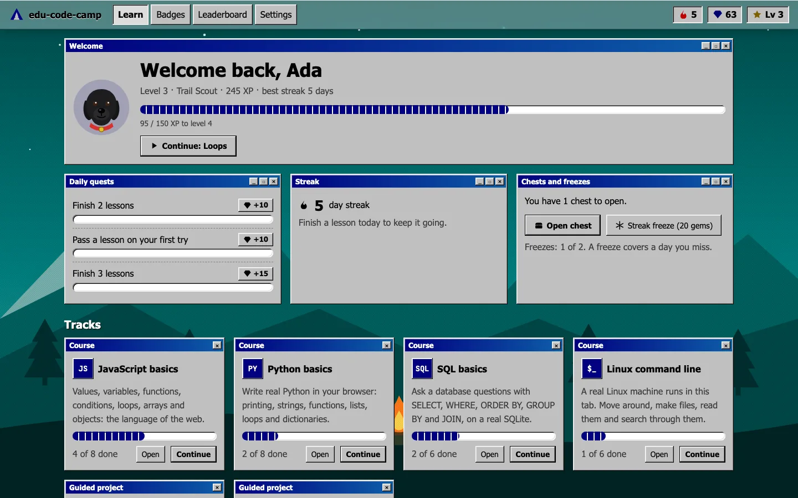

</div>

edu-code-camp is a free learning app in the spirit of boot.dev and freeCodeCamp. You read a short lesson, write code in the editor, press **Submit**, and hidden checks tell you what's right and what isn't. Passing earns XP, keeps your streak going, and fills your chest. Everything runs on your device: JavaScript in a sandboxed worker, Python through Pyodide, SQL on SQLite, and the Linux lessons on a real Alpine Linux machine inside the tab. There's no server and no account, and your progress never leaves your browser.

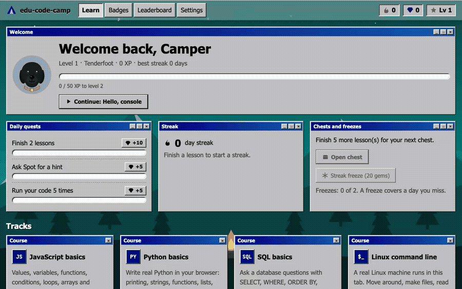

## What's inside

| Track | Lessons | Runs on |
|---|---|---|
| JavaScript basics | 8 | A Web Worker, stopped after 4 s if a loop never ends |
| Python basics | 8 | Pyodide (CPython in WebAssembly) |
| SQL basics | 6 | sql.js (SQLite), with a fresh camp database per run |
| Linux command line | 6 | Alpine Linux in v86, booted in the tab |
| Project: camp to-do list | 5 steps | Python; each step starts from your code for the step before |
| Project: shell scavenger hunt | 4 steps | Linux: `find`, `grep -r`, `sort \| uniq -c`, `chmod` |

All lessons are original and written for edu-code-camp.

**Game:** XP and levels with camp ranks, a daily streak with streak freezes, gems, a chest every five lessons (gems, double XP, or a freeze), 17 badges, three daily quests, and a leaderboard of the campers on this device.

**Spot the tutor:** a black labrador with a red collar who gives hints, not answers. Spot runs MiniCPM-V 4.7 1B through wllama (llama.cpp in WebAssembly, on WebGPU when the browser has it). It's a 672 MB download from Hugging Face, made only when you press **Download Spot**. Every 64 MiB part is checked against a pinned SHA-256, and the model then stays in the browser for offline use. Spot sees the lesson, your code and the failing checks. Code blocks longer than one line are removed from its replies.

**Progress:** stored in IndexedDB on this device. Use **Settings → Export progress** to save a JSON backup, and **Import a backup** in another browser.

<table>
<tr>
<td>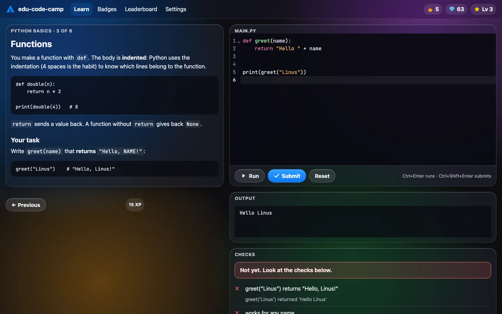</td>
<td>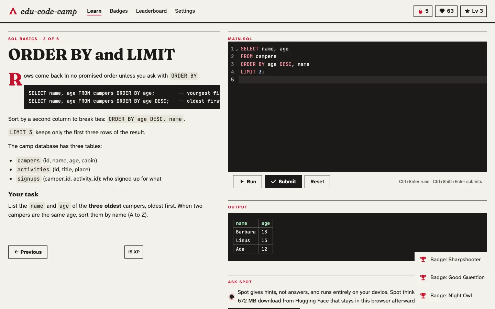</td>
</tr>
</table>

## Eight looks

Pick one in **Settings**. Each is inspired by one of the author's own projects.

| | | | |
|---|---|---|---|
|  **Win98 + glass**<br>qrer, Retrofind, Paint97 | 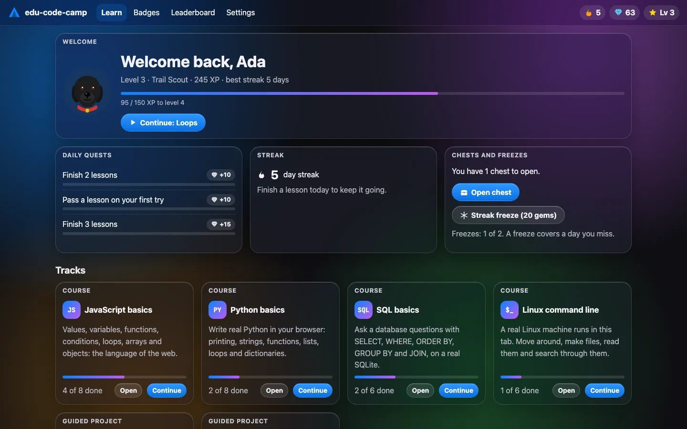 **Liquid glass**<br>GlassPaint, pikado, liquidframe | 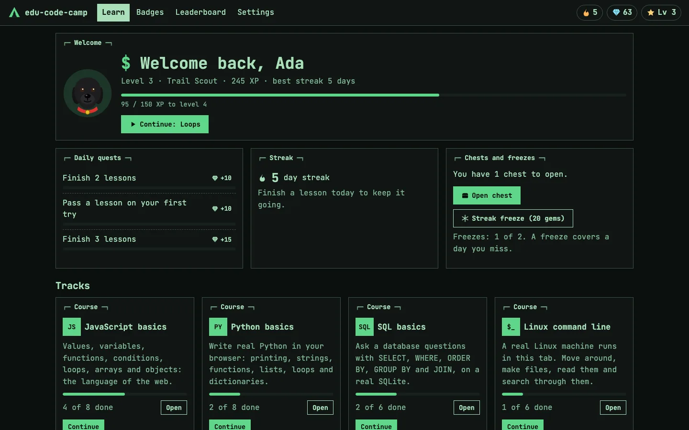 **Terminal** (mint, amber, crt)<br>Gitguy268 shell, TabShell | 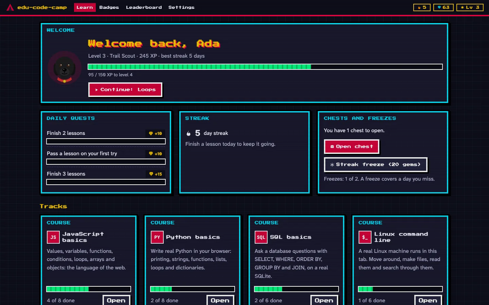 **8-bit arcade**<br>8bit-player, cozy-christmas-lab |
| 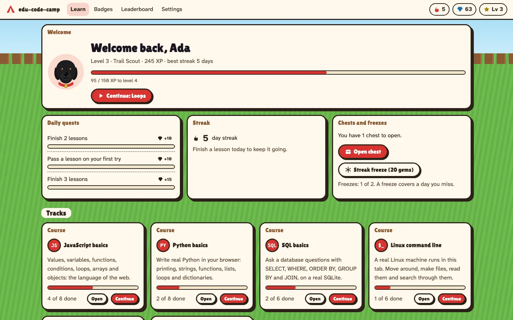 **Spot's yard**<br>spot-snake, spot-light | 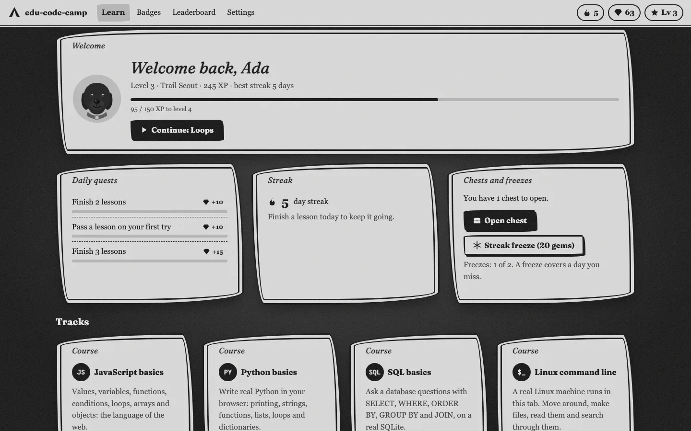 **Rubber hose**<br>rubber-hose-revue | 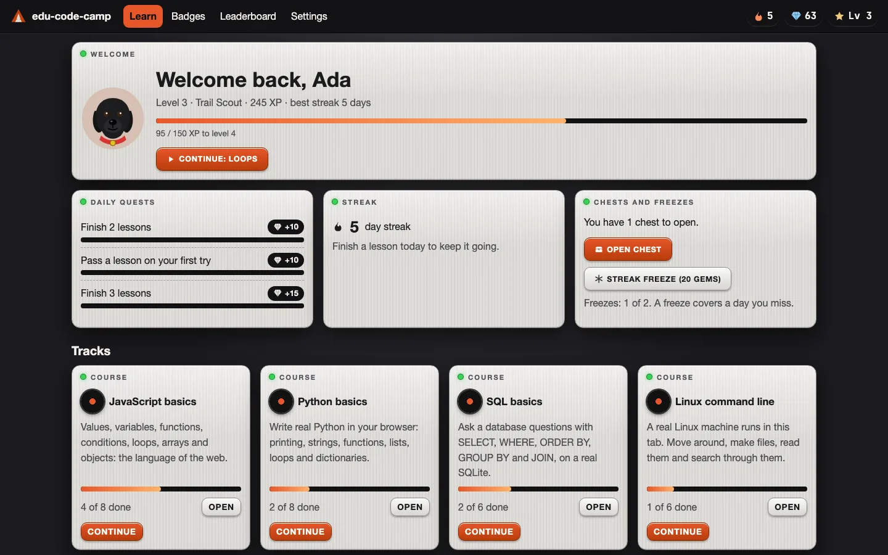 **Hi-fi deck**<br>Vinyl-Player, iPod classic | 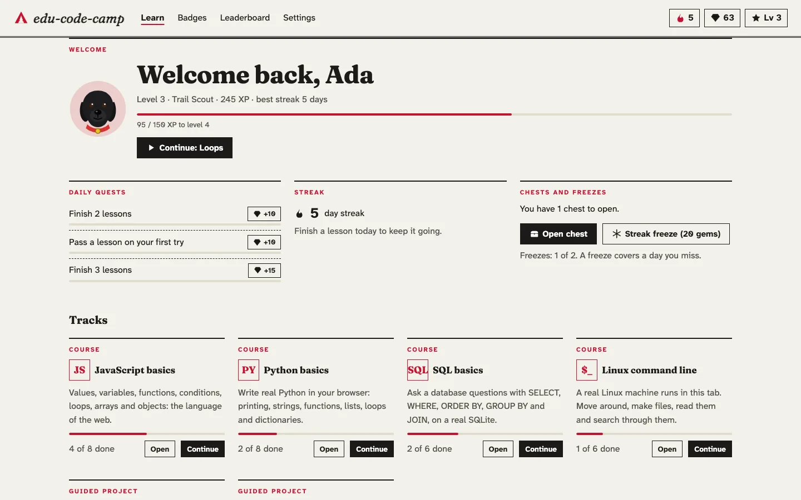 **Editorial paper**<br>print editorial |

Every look passes an automated colour-contrast check (axe) on the home, lesson, badges and settings pages. The rubber-hose film grain and flicker stop when your system asks for reduced motion.

## Run it locally

**On a Mac, without a terminal:** double-click `start.command`. It installs what's missing, builds the app, starts it on <http://localhost:5281> and opens your browser. Opening `index.html` directly doesn't work, because browsers block the code runners on `file://` pages. The page tells you so.

**With a terminal** (Node.js 20 or newer):

```sh
npm ci
npm run image     # optional, needs Docker: builds the Linux image for the command-line lessons
npm run build
npx vite preview  # http://localhost:5281
```

`npm run dev` serves a development build on the same port. Without the Linux image, everything except the Linux lessons and the scavenger hunt works.

<details>
<summary><strong>How it works</strong></summary>

- **Lessons** live in `content/<track>/<nn>-<slug>/` as `lesson.md`, a starter file, hidden tests and a solution. Vite bundles everything except the solutions, which only `npm run selfcheck` uses. See [content/README.md](content/README.md).
- **Runners** (`src/runners/`) are one Web Worker per language. A run that takes too long is stopped by terminating the worker, which needs no SharedArrayBuffer, so it works on GitHub Pages. The JS, Python and SQL harnesses are plain modules that also run in Node for the self-check.
- **Linux lessons** (`src/vm/vm.js`, ported from TabShell) run Alpine Linux i386 in v86 from a 9p filesystem. You type into the virtio console. Lesson setup and checks go over the serial port to a small agent in the image (`image/camp-agent`), so they never show in your terminal. The VM is saved to IndexedDB, so it resumes where you left it. It has no network.
- **Spot** (`src/tutor/`) downloads the model in ranges and caches them with the Cache API, then loads them into wllama. The prompt is in `src/tutor/prompt.js`.
- **Offline:** a service worker scoped to the app's folder precaches the app, Pyodide and sql.js on the first visit. The Linux image (about 40 MB) and Spot's engine are cached the first time you use them.

</details>

<details>
<summary><strong>Checks</strong></summary>

```sh
npm run check      # lint, build, and every lesson: the solution passes its tests and the starter doesn't
npm test           # unit tests for the game rules, then the Playwright suite against the build
npm run screenshots  # regenerates docs/images (needs the preview server running)
```

The self-check runs the Linux lessons in an Alpine container when Docker works, otherwise in the host's own `sh`. The Playwright suite covers one lesson per runner (including a full boot of the Linux VM), drafts, the endless-loop stop, export and import, the leaderboard, the tutor with a scripted engine, offline use, the `file://` notice, and contrast in all eight looks.

</details>

<details>
<summary><strong>Privacy</strong></summary>

edu-code-camp has no server and no analytics. The only network requests after the first load are the ones you start: downloading Spot's model from Hugging Face. Your code, progress and the Linux VM stay in this browser's storage until you clear it.

</details>

## Contributing

New lessons, looks and fixes are welcome. See [CONTRIBUTING.md](CONTRIBUTING.md). Please report security problems privately, as [SECURITY.md](SECURITY.md) describes.

## Licence

MIT © Lucas Van De Weerd. See [LICENSE](LICENSE). Bundled and downloaded third-party software keeps its own licence, listed in [NOTICE](NOTICE). Among them, Pyodide is MPL-2.0 (shipped unmodified), the Linux image contains GPL software, and Spot's model is Apache-2.0 and not part of the MIT grant. edu-code-camp is not affiliated with freeCodeCamp, boot.dev or Microsoft.
